# Duvardan Kaçan Kaplumbağa

### ROS 2 Humble ve turtlesim Üzerinde Sınır Algılamalı Otonom Yön Değiştirme Düğümünün Tasarımı, Gerçeklenmesi ve Deneysel Değerlendirmesi

| | |
|---|---|
| **Hazırlayan** | Kadriye Nur Metin |
| **Kurum / Bölüm** | Konya Teknik Üniversitesi, Yazılım Mühendisliği |
| **Paket adı** | `turtle_duvar_py` |
| **Yazılım platformu** | ROS 2 Humble Hawksbill, Python (`rclpy`) |
| **Depo** | https://github.com/kdrynrmtn/duvardan_kacan_kaplumbaga |
| **Tarih** | Ekim 2026 |

---

## İçindekiler

1. [Özet](#1-özet)
2. [Giriş](#2-giriş)
3. [Kuramsal Arka Plan](#3-kuramsal-arka-plan)
4. [Uygulama: Adım Adım Gerçekleme](#4-uygulama-adım-adım-gerçekleme)
5. [Derleme ve Çalıştırma Kılavuzu](#5-derleme-ve-çalıştırma-kılavuzu)
6. [Parametre Deneyleri (Bonus)](#6-parametre-deneyleri-bonus)
7. [Sonuç](#7-sonuç)
8. [Depo Yapısı](#8-depo-yapısı)


---

## 1. Özet

Bu çalışmada, ROS 2 Humble ortamında çalışan `turtlesim` simülatöründeki kaplumbağanın (`turtle1`), çalışma alanının sınırlarına yaklaştığında kendiliğinden yön değiştirerek hareketine devam etmesini sağlayan bir kontrol düğümü geliştirilmiştir. Düğüm, `/turtle1/pose` konusuna abone olarak kaplumbağanın konumunu ve yönelimini (`x`, `y`, `theta`) almakta; `/turtle1/cmd_vel` konusuna `geometry_msgs/msg/Twist` mesajları yayımlayarak kaplumbağayı ileri sürmekte ve konum `x` ya da `y` koordinatlarından biri belirlenen alt sınırın altına ya da üst sınırın üstüne çıktığında dönüş manevrası başlatmaktadır. Güncel konum bilgisi bir zamanlayıcı aracılığıyla saniyede bir kez günlüğe yazılmaktadır.

Bonus kapsamında doğrusal hız, dönüş hızı ve sınır değerleri ROS 2 parametreleri olarak tanımlanmış; bu parametrelerin düğüm yeniden başlatılmadan, `ros2 param set` komutuyla çalışma zamanında değiştirilebildiği deneysel olarak gösterilmiştir. Geliştirme sürecinde elde edilen 17 ekran görüntüsü, tasarım kararlarını ve davranışı belgelemek üzere nicel gözlemlerle birlikte sunulmuştur.

---

## 2. Giriş

### 2.1 Amaç ve Kapsam

Ödevin amacı; bir ROS 2 Python paketinin sıfırdan oluşturulması, konu (*topic*) tabanlı iletişimin hem abone hem yayıncı yönüyle uygulanması, zamanlayıcı kullanımı ve parametrelerle yapılandırılabilir bir düğüm tasarlanmasıdır. Çalışma; paket yapısının kurulması, düğümün gerçeklenmesi, derlenmesi, çalıştırılması ve davranışının deneysel olarak doğrulanması adımlarını kapsar.

### 2.2 Gereksinimler ve Karşılanma Durumu

**Tablo 1.** Ödev gereksinimleri ile bu çalışmadaki karşılıkları.

| # | Gereksinim | Gerçekleme | Kanıt |
|---|---|---|---|
| G1 | `turtle_duvar_py` paketi `rclpy`, `geometry_msgs`, `turtlesim` bağımlılıklarıyla oluşturulmalı | `ros2 pkg create --build-type ament_python` komutuyla üç bağımlılık belirtilerek oluşturuldu | Şekil 2 |
| G2 | `/turtle1/pose` konusu dinlenmeli, `x` ve `y` alınmalı | `turtlesim/msg/Pose` abonesi; geri çağırım fonksiyonu `konum_geldi` | Şekil 5 |
| G3 | `/turtle1/cmd_vel` ile kaplumbağa ileri sürülmeli | `geometry_msgs/msg/Twist` yayıncısı | Şekil 5, 13 |
| G4 | `x` veya `y` değeri 1.0'dan küçük ya da 10.0'dan büyükse dönerek yön değiştirilmeli | Sınır aşımında dönüş durumuna geçiş; günlükte `Duvara yaklasildi, yon degistiriliyor.` | Şekil 5, 13–15 |
| G5 | Konum saniyede bir `get_logger().info()` ile yazdırılmalı | 1.0 s periyotlu `create_timer` | Şekil 5 |
| B | **Bonus:** hız ve sınır değerleri parametre olmalı | `hareket_hizi`, `donus_hizi`, `alt_sinir`, `ust_sinir` | Şekil 13–16 |

---

## 3. Kuramsal Arka Plan

### 3.1 ROS 2 Düğümleri ve Konu Tabanlı İletişim

ROS 2'de bir uygulama, her biri tek bir sorumluluğu yerine getiren **düğümler** (*nodes*) topluluğu olarak kurgulanır. Düğümler arası asenkron veri akışı, **konular** (*topics*) üzerinden **yayıncı–abone** (*publisher–subscriber*) modeliyle gerçekleştirilir. Bir konunun veri türü bir **mesaj** tanımıyla belirlenir; yayıncı ile abone aynı tür üzerinde anlaşmak zorundadır [1], [2].

### 3.2 turtlesim, `Pose` ve `Twist`

`turtlesim`, ROS kavramlarını öğretmek amacıyla geliştirilmiş iki boyutlu bir simülatördür [3]. Bu çalışmada kullanılan iki arayüz şunlardır:

- **`turtlesim/msg/Pose`:** Kaplumbağanın konumunu (`x`, `y`), yönelimini (`theta`, radyan) ve anlık doğrusal/açısal hızını taşır. `turtlesim_node` bu mesajı `/turtle1/pose` konusunda yayımlar.
- **`geometry_msgs/msg/Twist`:** Doğrusal (`linear`) ve açısal (`angular`) hız vektörlerinden oluşur. İki boyutlu kaplumbağa için yalnızca `linear.x` (ileri hız) ile `angular.z` (dönüş hızı) anlamlıdır. `turtlesim_node` bu mesajı `/turtle1/cmd_vel` konusundan dinler.

Şekil 1'de görüldüğü üzere, her iki arayüz de kullanılan ROS 2 kurulumunda mevcuttur.

### 3.3 ROS 2 Parametreleri

Parametreler, bir düğümün davranışını kaynak kodu değiştirmeden yapılandırmaya yarayan, düğüme ait anahtar–değer çiftleridir. Bir parametrenin kullanılabilmesi için düğüm içinde `declare_parameter` ile bildirilmesi gerekir; bildirilmemiş bir parametreye erişim varsayılan olarak reddedilir [4]. Bu çalışmada bu davranış, Şekil 16'da yanlış yazılmış bir parametre adının reddedilmesiyle gözlemlenmiştir.

### 3.4 `ament_python` ve `colcon`

Python tabanlı ROS 2 paketleri `ament_python` derleme türüyle oluşturulur; paket meta verisi `package.xml`'de, kurulum ve çalıştırılabilir giriş noktaları ise `setup.py` içindeki `entry_points` alanında tanımlanır. Çalışma alanı `colcon build` ile derlenir ve `install/setup.bash` dosyasının `source` edilmesiyle ortama tanıtılır.

---


## 4. Uygulama: Adım Adım Gerçekleme

### Adım 1. Ortamın Doğrulanması

Geliştirmeye başlamadan önce, gerekli bileşenlerin ROS 2 kurulumunda bulunduğu aşağıdaki komutlarla doğrulanmıştır:

```bash
printenv ROS_DISTRO
ros2 pkg list | grep turtlesim
ros2 pkg executables turtlesim
ros2 interface list | grep -E "Twist|turtlesim/msg/Pose"
```

Çıktılar şunları göstermiştir: dağıtım **humble**'dır; `turtlesim` paketi kuruludur; paket `draw_square`, `mimic`, `turtle_teleop_key` ve `turtlesim_node` çalıştırılabilirlerini içermektedir; ayrıca `geometry_msgs/msg/Twist` ile `turtlesim/msg/Pose` arayüzleri kullanılabilir durumdadır.

<p align="center">
  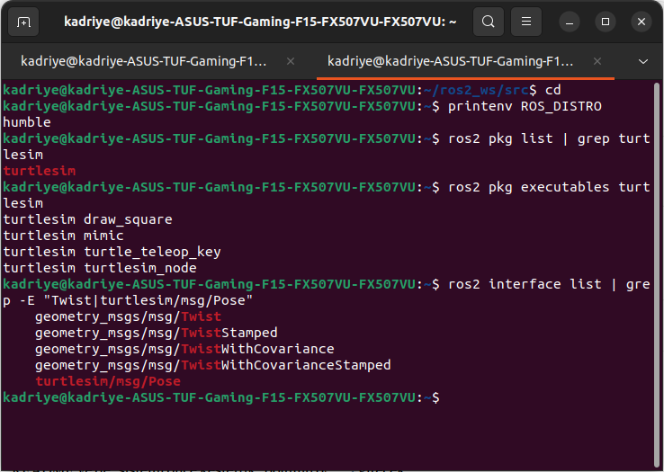<br>
  <em>Şekil 1. ROS dağıtımının, turtlesim paketinin ve Twist/Pose arayüzlerinin doğrulanması.</em>
</p>

### Adım 2. Paketin Oluşturulması (Gereksinim G1)

Paket, çalışma alanının `src` dizininde oluşturulmuştur:

```bash
cd ~/ros2_ws2/src
ros2 pkg create --build-type ament_python turtle_duvar_py --dependencies rclpy geometry_msgs turtlesim
```

Komut; `package.xml`, `setup.py`, `setup.cfg`, `resource/turtle_duvar_py`, `turtle_duvar_py/__init__.py` ve `test/` öğelerini üretmiştir. Çıktıda bağımlılıkların `['rclpy', 'geometry_msgs', 'turtlesim']` olarak kaydedildiği görülmektedir. Üstteki dosya yöneticisi penceresi, paket klasörünün `ros2_ws2/src/turtle_duvar_py` altında oluştuğunu doğrulamaktadır.

<p align="center">
  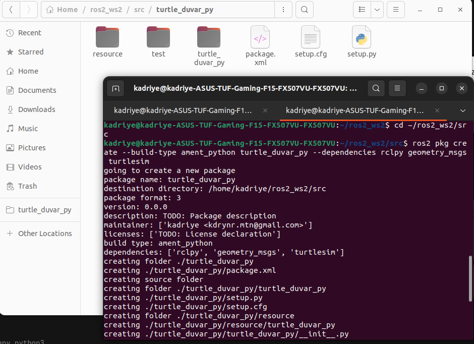<br>
  <em>Şekil 2. <code>ros2 pkg create</code> çıktısı ve oluşan paket iskeleti (<code>src</code> dizini içinde).</em>
</p>

> Paketin ilk denemede yanlış dizinde oluşturulması ve düzeltilmesi Bölüm 10'da (Sorun 1) ele alınmıştır.

### Adım 3. Düğüm Dosyasının Oluşturulması

İç `turtle_duvar_py` Python modülü dizininde düğümün kaynak dosyası oluşturulmuştur:

```bash
cd ~/ros2_ws2/src/turtle_duvar_py/turtle_duvar_py
touch duvardan_kacan.py
```

Dosya, `__init__.py` ile aynı dizinde yer almalıdır; çünkü `setup.py`'deki `find_packages` yalnızca Python paketi olarak tanınan dizinleri kurulum kapsamına alır.

<p align="center">
  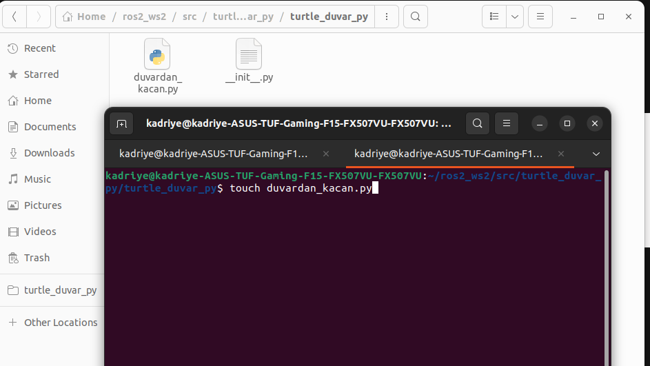<br>
  <em>Şekil 3. Düğüm dosyası <code>duvardan_kacan.py</code>'nin Python modülü dizininde oluşturulması.</em>
</p>

### Adım 4. Giriş Noktasının Tanımlanması (`setup.py`)

`ros2 run` komutunun düğümü bulabilmesi için `setup.py` içindeki `entry_points` alanına bir konsol betiği eklenmiştir:

```python
entry_points={
    'console_scripts': [
        'duvardan_kacan_node = turtle_duvar_py.duvardan_kacan:main',
    ],
},
```

Bu tanım; `duvardan_kacan_node` adlı çalıştırılabilirin, `turtle_duvar_py.duvardan_kacan` modülündeki `main` fonksiyonunu çağıracağını bildirir. Çalıştırılabilir adı ile ROS düğüm adı (`duvar_kontrol`) birbirinden bağımsızdır: ilki `ros2 run` ile kullanılan komut adı, ikincisi ROS ağındaki düğüm kimliğidir.

<p align="center">
  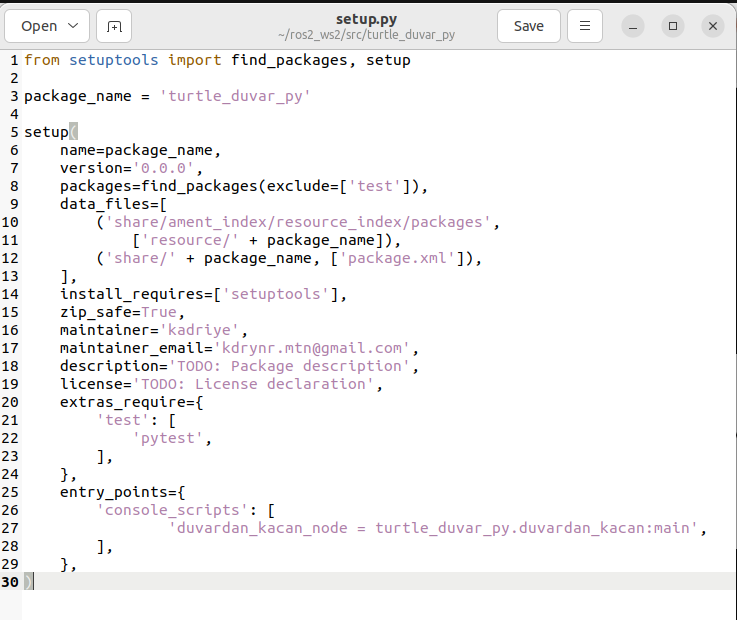<br>
  <em>Şekil 4. <code>setup.py</code> dosyasında <code>console_scripts</code> girişinin tanımlanması.</em>
</p>

### Adım 5. Düğümün Gerçeklenmesi (Gereksinimler G2–G5)

Düğüm, `rclpy.node.Node` sınıfından türetilen `DuvarKontrol` sınıfı olarak yazılmıştır. Aşağıda dosyanın başlangıç bölümü (satır 1–54) verilmiştir:

```python
import math

import rclpy
from rclpy.node import Node
from geometry_msgs.msg import Twist
from turtlesim.msg import Pose


class DuvarKontrol(Node):

    def __init__(self):
        super().__init__('duvar_kontrol')

        # Kaplumbağanın son konumunu saklayacağız.
        self.x = 5.5
        self.y = 5.5
        self.aci = 0.0

        # Dönüş durumunu takip ediyoruz.
        self.donuyor = False
        self.hedef_aci = 0.0

        # Konum bilgilerini okuyan abone.
        self.abone = self.create_subscription(
            Pose,
            '/turtle1/pose',
            self.konum_geldi,
            10
        )

        # Hareket komutlarını gönderen yayıncı.
        self.yayinci = self.create_publisher(
            Twist,
            '/turtle1/cmd_vel',
            10
        )

        # Her saniye konum yazdıran zamanlayıcı.
        self.zamanlayici = self.create_timer(
            1.0,
            self.konum_yazdir
        )

        self.get_logger().info(
            'Duvar kontrol dugumu baslatildi.'
        )

    def konum_geldi(self, mesaj):
        # Güncel konumu sakla.
        self.x = mesaj.x
        self.y = mesaj.y
        self.aci = mesaj.theta

        twist = Twist()
        ...
```

Kod bölümlere ayrılarak incelendiğinde tasarım kararları şöyle özetlenebilir:

| Satırlar | İşlev | Gerekçe |
|---|---|---|
| 1–6 | `math`, `rclpy`, `Node`, `Twist`, `Pose` içe aktarımları | `Twist` ve `Pose`, sırasıyla `geometry_msgs` ve `turtlesim` bağımlılıklarından gelir; `math` açı hesapları içindir |
| 9–12 | `DuvarKontrol(Node)` sınıfı, düğüm adı `duvar_kontrol` | Düğüm kimliği; `ros2 param set /duvar_kontrol ...` komutlarında kullanılır |
| 14–17 | `x`, `y`, `aci` durum değişkenleri (5.5, 5.5, 0.0) | Kaplumbağanın başlangıç konumu (≈ 5.54, 5.54) ile uyumlu başlangıç değerleri; ilk `Pose` mesajıyla güncellenir |
| 19–21 | `donuyor`, `hedef_aci` | İki durumlu kontrol yapısının durum bayrağı ve dönüş hedefi |
| 23–29 | `/turtle1/pose` aboneliği, kuyruk derinliği 10 | Konum verisinin alınması (G2) |
| 31–36 | `/turtle1/cmd_vel` yayıncısı, kuyruk derinliği 10 | Hız komutunun gönderilmesi (G3) |
| 38–42 | `create_timer(1.0, self.konum_yazdir)` | Saniyede bir konum günlüğü (G5) |
| 44–46 | Başlangıç bilgilendirme günlüğü | Düğümün ayağa kalktığının doğrulanması |
| 48–52 | `konum_geldi` geri çağırımı | Her `Pose` mesajında durumun güncellenmesi ve kontrol kararının verilmesi (G4) |

Sınır denetimi, dönüş manevrası ve parametre bildirimlerinin yer aldığı kalan bölüm için tam kaynak kod `turtle_duvar_py/duvardan_kacan.py` dosyasındadır.

<p align="center">
  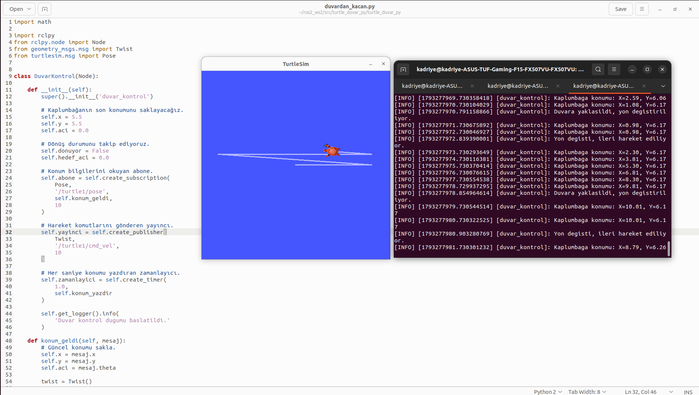<br>
  <em>Şekil 5. Kaynak kodun başlangıç bölümü (solda), simülatör penceresi (ortada) ve düğüm günlükleri (sağda).</em>
</p>

Şekil 5'teki günlük çıktısı, düğümün nihai sürümündeki üç ileti türünü açıkça göstermektedir:

- `Kaplumbaga konumu: X=..., Y=...` — zamanlayıcıdan gelen, saniyede bir tekrarlanan konum iletisi (örneğin zaman damgaları `...977.73`, `...978.73`);
- `Duvara yaklasildi, yon degistiriliyor.` — sınır ihlali algılandığında dönüşün başladığı an;
- `Yon degisti, ileri hareket ediliyor.` — dönüşün tamamlanıp ileri harekete dönüldüğü an.

Simülatör penceresindeki izler, kaplumbağanın alanı yatay doğrultuda tekrar tekrar kat ettiğini ve her duvar temasında yön değiştirdiğini göstermektedir.

### Adım 6. Derleme

Derleme, çalışma alanının kök dizininde yapılmıştır:

```bash
cd ~/ros2_ws2
colcon build
```

Çıktıda `turtle_duvar_py` paketinin **0.51 s** içinde hatasız derlendiği, özette ise `1 package finished` ifadesi görülmektedir.

<p align="center">
  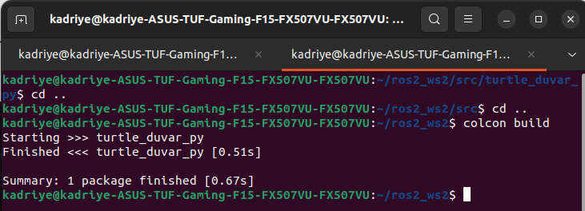<br>
  <em>Şekil 6. <code>colcon build</code> çıktısı: paket hatasız derlenmiştir.</em>
</p>

### Adım 7. Ortamın Tanıtılması

Derleme çıktılarının (`install/` dizini) mevcut terminal oturumunda tanınması için kurulum betiği `source` edilmiştir. Bu işlem, kullanılan her yeni terminalde yinelenmelidir.

```bash
source install/setup.bash
```

<p align="center">
  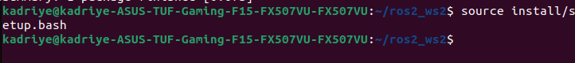<br>
  <em>Şekil 7. <code>install/setup.bash</code> dosyasının <code>source</code> edilmesi.</em>
</p>

---

## 5. Derleme ve Çalıştırma Kılavuzu

Aşağıdaki adımlar, depoyu sıfırdan edinen bir kullanıcının sonuçları yeniden üretebilmesi için verilmiştir.

**1) Depoyu çalışma alanına klonlayın ve derleyin**

```bash
mkdir -p ~/ros2_ws2/src && cd ~/ros2_ws2/src
git clone https://github.com/kdrynrmtn/turtle_duvar_py.git
cd ~/ros2_ws2
colcon build --packages-select turtle_duvar_py
source install/setup.bash
```

**2) 1. terminal: simülatörü başlatın**

```bash
source /opt/ros/humble/setup.bash
ros2 run turtlesim turtlesim_node
```

Şekil 8'de görüldüğü gibi, simülatör `turtle1` adlı kaplumbağayı alanın ortasında (x ≈ 5.544, y ≈ 5.544, theta = 0) oluşturur.

<p align="center">
  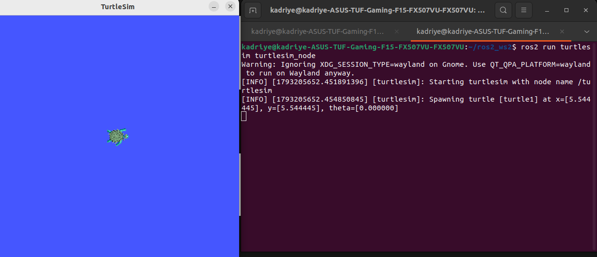<br>
  <em>Şekil 8. <code>turtlesim_node</code>'un başlatılması ve kaplumbağanın başlangıç durumu.</em>
</p>

**3) 2. terminal: kontrol düğümünü başlatın**

```bash
cd ~/ros2_ws2 && source install/setup.bash
ros2 run turtle_duvar_py duvardan_kacan_node
```

**4) 3. terminal (isteğe bağlı): parametreleri çalışma zamanında değiştirin**

```bash
cd ~/ros2_ws2 && source install/setup.bash
ros2 param set /duvar_kontrol hareket_hizi 2.0
ros2 param set /duvar_kontrol donus_hizi   2.0
ros2 param set /duvar_kontrol alt_sinir    2.0
ros2 param set /duvar_kontrol ust_sinir    9.0
```

Mevcut parametreleri listelemek için `ros2 param list /duvar_kontrol`, tek bir değeri okumak için `ros2 param get /duvar_kontrol hareket_hizi` komutları kullanılabilir.


---

## 6. Parametre Deneyleri (Bonus)

Bonus gereksiniminin sağlandığını göstermek için dört parametre, düğüm **çalışırken** `ros2 param set` ile değiştirilmiş ve davranıştaki değişim günlüklerden ölçülmüştür. Deneyler art arda uygulanmıştır; yani her deney, önceki deneylerde ayarlanan değerleri korumaktadır.

### 6.1 Deney 1: Doğrusal Hız (`hareket_hizi`)

```bash
ros2 param set /duvar_kontrol hareket_hizi 2.0
```

Komut sonrasında `Set parameter successful` iletisi alınmıştır. Değişimden önce ardışık saniyelerdeki `X` artışı ≈ **1.5 birim** iken (`6.76 → 8.27 → 9.76`), değişimden sonra ≈ **2.0 birim** olmuştur (`8.46 → 6.48 → 4.47 → 2.49` ve `1.41 → 3.39`). Hız değişimi düğüm yeniden başlatılmadan etkili olmuştur.

<p align="center">
  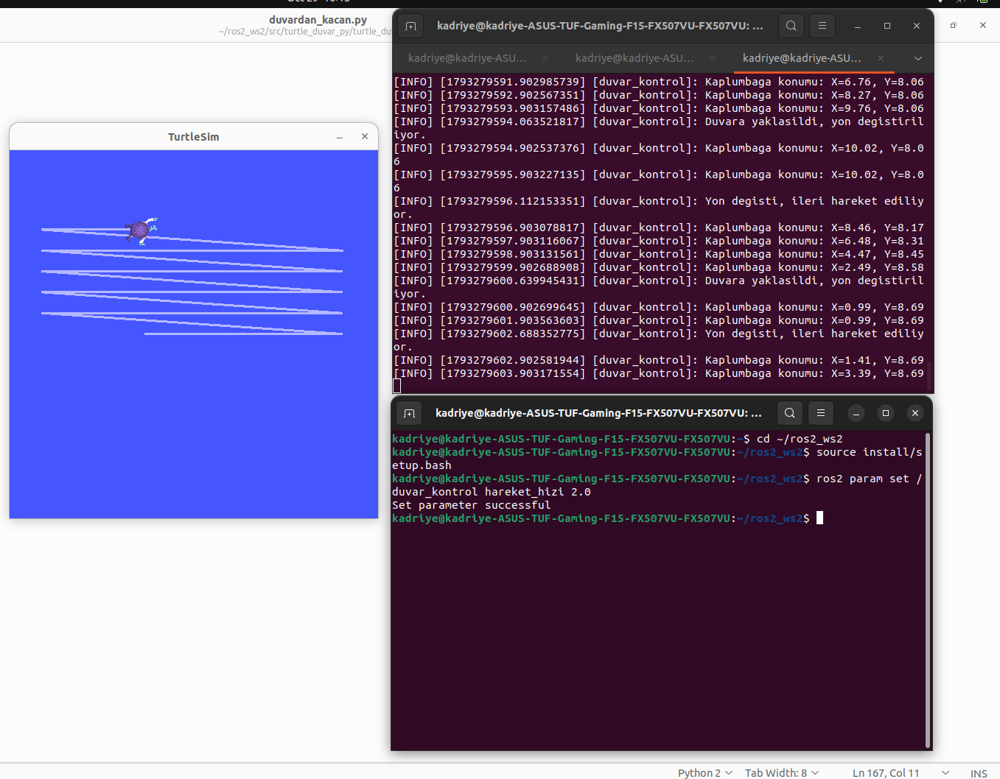<br>
  <em>Şekil 13. <code>hareket_hizi = 2.0</code> ayarı ve konum artışındaki değişim.</em>
</p>

### 6.2 Deney 2: Dönüş Hızı (`donus_hizi`)

```bash
ros2 param set /duvar_kontrol donus_hizi 2.0
```

Dönüş süresi, `Duvara yaklasildi` ile `Yon degisti` iletileri arasındaki zaman farkından ölçülmüştür. Varsayılan hızla süre ≈ **2.05 s** (Şekil 5'te `...970.79 → ...972.84` ve `...978.85 → ...980.90`), `donus_hizi = 2.0` ile ≈ **1.54 s** olmuştur (Şekil 14'te `...641.18 → ...642.72` ve `...642.74 → ...644.27`).

Şekil 14'te ayrıca `Y = 10.00` değerinde üst sınır ihlali nedeniyle art arda dönüşlerin gerçekleştiği, yani sınır denetiminin yalnızca `x` için değil `y` için de çalıştığı görülmektedir.

<p align="center">
  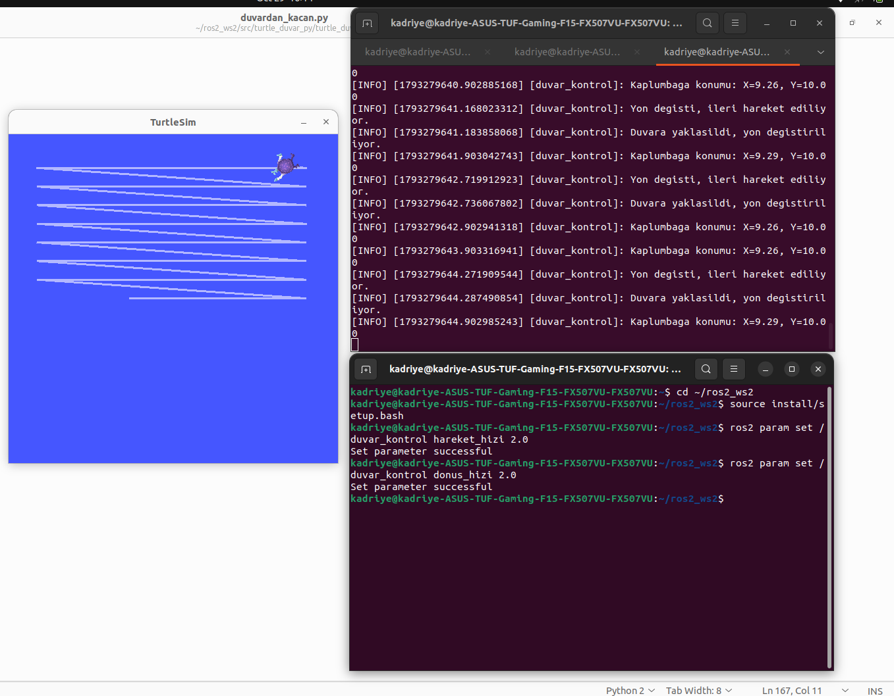<br>
  <em>Şekil 14. <code>donus_hizi = 2.0</code> ayarı ve üst sınırda (Y = 10.00) tekrarlanan dönüşler.</em>
</p>

### 6.3 Deney 3: Alt Sınır (`alt_sinir`)

```bash
ros2 param set /duvar_kontrol alt_sinir 2.0
```

Değişimden önce kaplumbağa sol tarafta `X ≈ 0.99` değerinde yön değiştirirken (Şekil 13), değişimden sonra `X = 1.99` değerinde yön değiştirmiştir (Şekil 15'te `X=4.00 → X=1.99 → Duvara yaklasildi`). Böylece sanal duvarın konumunun parametreyle taşınabildiği gösterilmiştir.

<p align="center">
  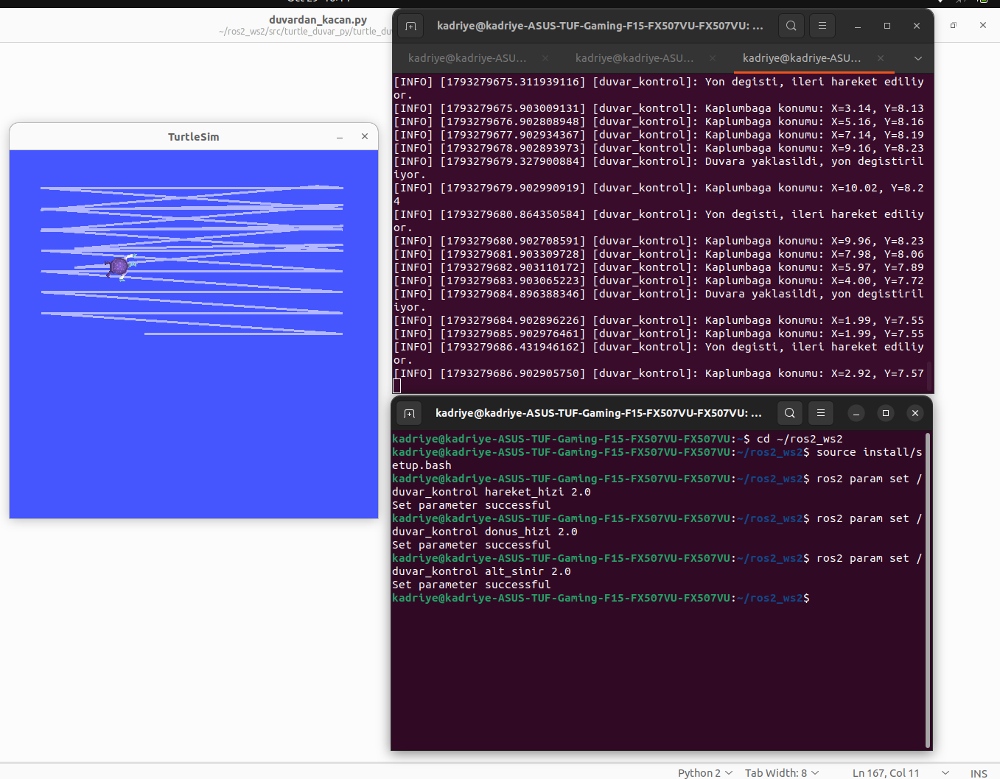<br>
  <em>Şekil 15. <code>alt_sinir = 2.0</code> ayarı: sol dönüş noktası X ≈ 0.99'dan X ≈ 1.99'a kaymıştır.</em>
</p>


### 6.4 Deney Sonuçlarının Özeti

**Tablo 4.** Parametre deneyleri.

| Deney | Komut | Ölçülen büyüklük | Önce | Sonra | Şekil |
|---|---|---|---|---|---|
| 1 | `hareket_hizi 2.0` | Saniyedeki `X` değişimi | ≈ 1.5 birim/s | ≈ 2.0 birim/s | 13 |
| 2 | `donus_hizi 2.0` | Dönüş süresi | ≈ 2.05 s | ≈ 1.54 s | 14 |
| 3 | `alt_sinir 2.0` | Sol dönüş noktası | `X ≈ 0.99` | `X ≈ 1.99` | 15 |
| 4a | `ust__sinir 2.0` (hatalı ad) | Komut sonucu | — | Reddedildi | 16 |

Dört parametrenin tamamı çalışma zamanında etkili olmuştur; bu, bonus gereksinimin sağlandığını göstermektedir.

---

## 7. Sonuç

Bu çalışmada `turtle_duvar_py` paketi `ament_python` türünde, `rclpy`, `geometry_msgs` ve `turtlesim` bağımlılıklarıyla oluşturulmuş; `/turtle1/pose` konusundan konum okuyan, `/turtle1/cmd_vel` konusuna hız komutu yayımlayan ve alan sınırlarında yön değiştiren bir düğüm geliştirilmiştir. Konum bilgisi 1 s periyotlu bir zamanlayıcıyla günlüğe yazılmıştır. Bonus kapsamında hareket hızı, dönüş hızı ve sınır değerleri ROS 2 parametresi yapılmış; dört parametrenin tamamının çalışma zamanında değiştirilebildiği ve beklenen etkiyi doğurduğu ölçümlerle gösterilmiştir (Tablo 4). Geliştirme süreci üç aşamada belgelenmiş, karşılaşılan sorunlar ve çözümleri raporlanmıştır.

---

## 8. Depo Yapısı

```text
turtle_duvar_py/
├── package.xml
├── setup.py
├── setup.cfg
├── resource/
│   └── turtle_duvar_py
├── test/
├── turtle_duvar_py/
│   ├── __init__.py
│   └── duvardan_kacan.py        # DuvarKontrol düğümü
├── docs/
│   └── images/                  # README'de kullanılan ekran görüntüleri
└── README.md
```

---

